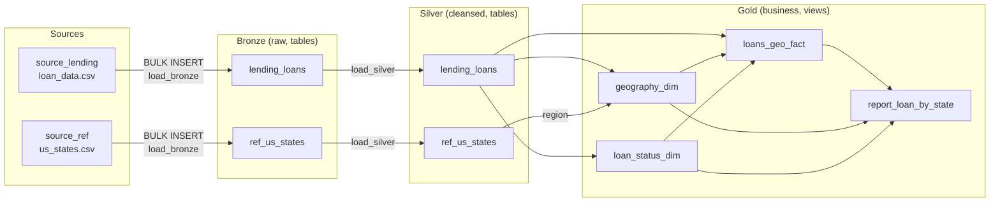
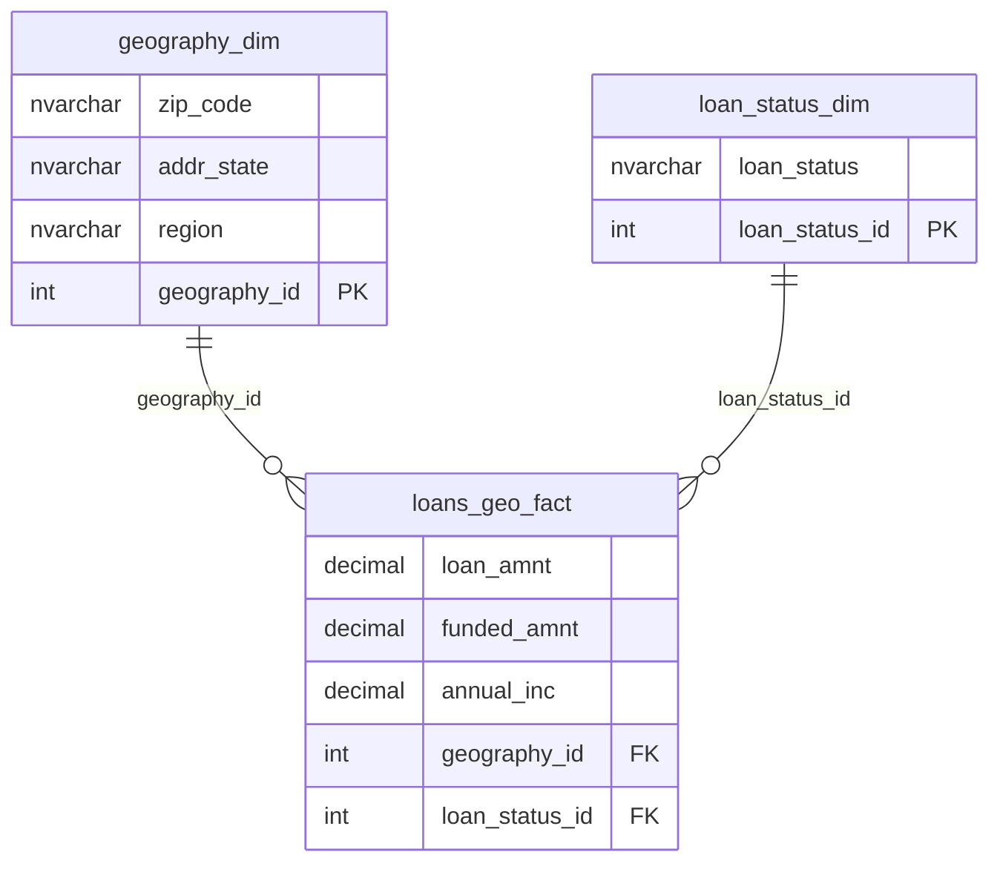

# Data Architecture

Medallion Architecture (Bronze → Silver → Gold) on SQL Server.

## Mapping: Business Questions → Use Case → Model

| Business question (Topic 4: Geographic dimension) | Use Case | Model |
|---|---|---|
| 4.1 Total loan amount by state (`addr_state`) | Descriptive Analytics | Data Model (Dimensional model) for Data Warehouse |
| 4.2 Average annual income (`annual_inc`) by state | Descriptive Analytics | Data Model (Dimensional model) for Data Warehouse |
| 4.3 Number of Charged Off loans (`loan_status`) by state | Descriptive Analytics | Data Model (Dimensional model) for Data Warehouse |

## Data Flow

| Layer  | Object type | Load method                        | Transformations |
|--------|-------------|------------------------------------|-----------------|
| Bronze | Table       | Full load (truncate + BULK INSERT) | None (as-is, all NVARCHAR) |
| Silver | Table       | Full load (truncate + insert)      | Type casting, cleansing, dedup, standardization |
| Gold   | View        | No load                            | Dimensional model (star schema), aggregation |

## Data Model (Star Schema)

