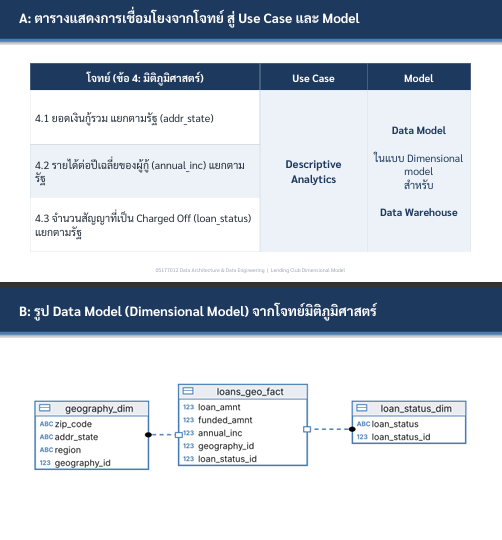

# Data Catalog for Gold Layer

## Overview
The Gold Layer is a dimensional model (star schema) for the **geographic dimension** topic, used for **Descriptive Analytics** to answer:

| # | Question | Measure |
|---|----------|---------|
| 4.1 | Total loan amount by state (`addr_state`) | SUM(`loan_amnt`) |
| 4.2 | Average annual income of borrowers by state | AVG(`annual_inc`) |
| 4.3 | Number of Charged Off loans (`loan_status`) by state | COUNT where `loan_status` = 'Charged Off' |

---

### 1. **gold.geography_dim**
- **Purpose:** Geographic dimension — one row per `zip_code` + `addr_state` combination.

| Column Name  | Data Type    | Description |
|--------------|--------------|-------------|
| geography_id | INT          | Surrogate key. |
| zip_code     | NVARCHAR(10) | First 3 digits of borrower zip code, e.g. '860xx'. 'n/a' if missing. |
| addr_state   | NVARCHAR(2)  | Two-letter state code, e.g. 'CA'. |
| region       | NVARCHAR(50) | US Census region (Northeast, Midwest, South, West) from `us_states.csv`. 'n/a' if not found. |

---

### 2. **gold.loan_status_dim**
- **Purpose:** Loan status dimension — one row per standardized status.

| Column Name    | Data Type    | Description |
|----------------|--------------|-------------|
| loan_status_id | INT          | Surrogate key. |
| loan_status    | NVARCHAR(50) | Standardized status, e.g. 'Fully Paid', 'Charged Off', 'Current'. |

---

### 3. **gold.loans_geo_fact**
- **Purpose:** One row per loan contract, holding the measures and foreign keys.

| Column Name    | Data Type     | Description |
|----------------|---------------|-------------|
| loan_amnt      | DECIMAL(18,2) | Amount the borrower applied for. **Measure for 4.1.** |
| funded_amnt    | DECIMAL(18,2) | Amount committed to the loan. |
| annual_inc     | DECIMAL(18,2) | Borrower's self-reported annual income; NULL if missing or ≤ 0. **Measure for 4.2.** |
| geography_id   | INT           | FK → `geography_dim`. |
| loan_status_id | INT           | FK → `loan_status_dim`. **Used for 4.3.** |

---

### 4. **gold.report_loan_by_state**
- **Purpose:** Final answer view — one row per state.

| Column Name       | Data Type     | Description |
|-------------------|---------------|-------------|
| addr_state        | NVARCHAR(2)   | Two-letter state code. |
| region            | NVARCHAR(50)  | Census region. |
| total_loans       | INT           | Number of loan contracts. |
| total_loan_amnt   | DECIMAL       | **4.1** — SUM(loan_amnt). |
| avg_annual_inc    | DECIMAL(18,2) | **4.2** — AVG(annual_inc), NULL incomes excluded. |
| charged_off_loans | INT           | **4.3** — number of loans with status 'Charged Off'. |
